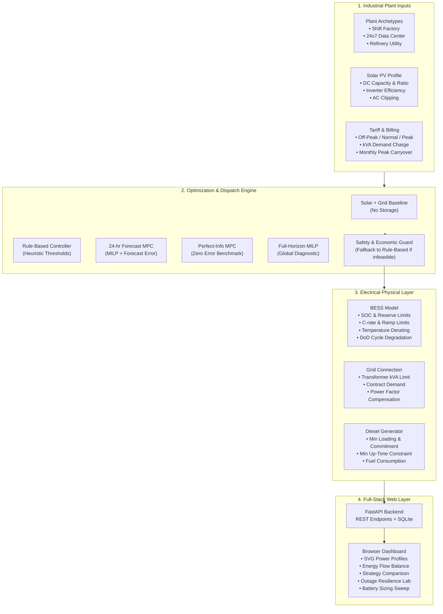

<div align="center">

# ⚡ GridWise EMS
### Intelligent Industrial Solar, Battery & Grid Dispatch Optimization Engine

[](https://dhruvameena7855.github.io/GridWise-EMS-Industrial-Energy-Management/)
[](https://github.com/dhruvameena7855/GridWise-EMS-Industrial-Energy-Management/actions)
[](https://www.python.org/)
[](https://fastapi.tiangolo.com/)
[](https://github.com/coin-or/pulp)
[](https://www.docker.com/)
[](LICENSE)

<br/>

**A simulation-first, full-stack industrial energy management system (EMS) designed for electrical engineering portfolio evaluation.**

Models a 15-minute factory electrical profile and optimizes battery storage dispatch against solar variability, time-of-day (ToD) tariffs, kVA maximum demand charges, power factor penalties, transformer limits, and diesel generator commitments.

[🚀 **Launch Interactive Live Dashboard**](https://dhruvameena7855.github.io/GridWise-EMS-Industrial-Energy-Management/) · [📖 View API Documentation](#-api-endpoints) · [🏗️ Architecture Specs](docs/architecture.md)

</div>

---

## 🌟 Executive Summary

Industrial power consumers face multi-part electricity tariffs where **kVA demand charges** (billing for peak apparent power) and **time-of-day (ToD) energy charges** represent a substantial share of total utility expenses. Furthermore, power factor (PF) penalties and excess-demand penalties penalize uncoordinated solar or storage operation.

**GridWise EMS** delivers a rigorous decision-support and dispatch simulation engine:
- **15-Minute Simulation Interval:** Aligns with standard Indian utility tariff billing cycles.
- **kVA & Power Factor Integration:** Captures true apparent-power demand, power factor degradation, and reactive power compensation within inverter envelopes.
- **Rolling-Horizon MPC:** 24-hour lookahead mixed-integer programming with synthetic forecast noise and automatic fallback to rule-based safe dispatch.
- **Resilience & Sizing Lab:** Outage critical-load islanding checks and multi-capacity BESS financial sweeps (10-year NPV & simple payback).
- **Zero-Setup Live Web Demo:** Interactive client dashboard with pre-computed industrial archetypes running on GitHub Pages, backed by a FastAPI + PuLP local engine.

> **Scope & Safety Notice:** GridWise EMS is an engineering simulation and decision-support prototype. It uses synthetic demand and solar profiles by default. It is not connected to physical plant hardware and must not be used to operate live equipment without professional engineering validation.

---

## 🖥️ Live Dashboard Preview

Experience the live interactive control room directly in your browser without installing anything:

👉 **[Launch Live Interactive Dashboard on GitHub Pages](https://dhruvameena7855.github.io/GridWise-EMS-Industrial-Energy-Management/)**

```
 ┌─────────────────────────────────────────────────────────────────────────────┐
 │  GridWise EMS   Workspace: Overview   [Live Demo]   [Synthetic Profile]     │
 ├─────────────────────────────────────────────────────────────────────────────┤
 │   TOTAL COST        PEAK DEMAND         SOLAR USE          GRID CO₂         │
 │   ₹ 28,450          312 kVA             89.4%              1,842 kg         │
 ├─────────────────────────────────────────────────────────────────────────────┤
 │  POWER PROFILE (15-min intervals: Factory Load · Solar PV · Grid Import)    │
 │   kW │           ╭────────╮                                                 │
 │  400 ┼───────────╯        ╰─────────────────────╮                           │
 │  200 ┼──╮   ╭──────────────╮       ╭────────────╯                           │
 │    0 ┴──┴───┴──────────────┴───────┴────────────┴──────                     │
 │      00:00        06:00          12:00        18:00       24:00             │
 ├─────────────────────────────────────────────────────────────────────────────┤
 │  DISPATCH STRATEGY COMPARISON:                                              │
 │  • No-Storage Baseline:        ₹ 34,210  (Reference)                        │
 │  • Rule-Based Threshold:       ₹ 29,880  (-12.6%)                           │
 │  • Forecast Rolling MPC:       ₹ 28,450  (-16.8% · Active)                  │
 │  • Perfect-Information MPC:    ₹ 27,910  (-18.4% · Upper Bound)             │
 └─────────────────────────────────────────────────────────────────────────────┘
```

---

## 🏛️ System Architecture & Data Flow



---

## 📊 Dispatch Strategy Comparison

GridWise EMS implements and evaluates **five distinct dispatch paradigms** under identical electrical profiles and commercial tariff constraints:

| Strategy | Algorithm | Lookahead Horizon | Forecast Sensitivity | Economic Role |
|---|---|---|---|---|
| **1. Solar + Grid Baseline** | Direct consumption | None | None | Baseline reference showing unmitigated peak grid import and solar export |
| **2. Rule-Based Controller** | Deterministic threshold logic | None | Immune to forecast error | Safe fallback ensuring peak clipping and protected SOC reserve |
| **3. Forecast Rolling MPC** | Rolling-horizon MILP (PuLP/CBC) | 24 Hours (re-solved every step) | Evaluates realistic forecast noise ($\pm 5\text{--}15\%$) | **Primary deployable controller** with baseline safety guard |
| **4. Perfect-Information MPC** | Rolling-horizon MILP | 24 Hours | Idealized foresight ($0\%$ forecast error) | Quantifies **forecasting regret** and maximum capture rate |
| **5. Full-Horizon MILP** | Global MILP optimization | Full simulation period | Idealized global schedule | Theoretical mathematical diagnostic for offline benchmarking |

### Forecasting Regret Metric
The system reports **Forecasting Regret** in Indian Rupees ($\text{INR}$), measured as:
$$\text{Regret} = \text{Cost}_{\text{Forecast MPC}} - \text{Cost}_{\text{Perfect Foresight}}$$
This directly informs facility managers whether investing in higher-accuracy day-ahead irradiance or load forecasting yields positive ROI against battery savings.

---

## ⚡ Key Engineering & Electrical Models

### 1. kVA Demand & Power Factor (PF) Billing
Most industrial tariffs bill demand in **kVA** rather than **kW**, computed via:
$$\text{kVA} = \frac{\text{kW}}{\text{PF}} = \sqrt{\text{kW}^2 + \text{kVAR}^2}$$
When solar displaces active power ($\text{kW}$) without displacing reactive power ($\text{kVAR}$), the plant's operational power factor can degrade, inadvertently triggering utility penalties or keeping kVA demand artificially high. GridWise EMS models battery inverter reactive power compensation to protect billing power factor.

### 2. Battery Degradation & Depth-of-Discharge (DoD) Wear
Battery degradation is approximated using an exponential DoD-sensitive wear model:
$$\text{Cycle Wear Cost} = \text{Replacement Cost} \times \left(\frac{\Delta \text{DoD}}{2}\right) \times \left(\frac{\text{DoD}}{80\%}\right)^{\gamma}$$
This prevents the optimizer from cycling the battery for marginal energy arbitrage if the degradation cost exceeds the price spread.

### 3. Monthly Demand Peak Carry-Forward
Unlike simplistic daily simulators that reset demand charges every 24 hours, GridWise EMS tracks carried-in month-to-date billing peak demand ($\text{kVA}_{\text{prior}}$), accurately simulating real DISCOM billing mechanics.

### 4. Diesel Generator (DG) Commitment
Models startup costs, hourly operating costs, fuel consumption ($0.28\text{ L/kWh}$ default), minimum loading fraction ($30\%$), and minimum up-time commitments ($60\text{ minutes}$) via mixed-integer constraints.

---

## 🏭 Industrial Archetypes Included

The simulation engine includes three pre-calibrated synthetic industrial archetypes:

1. **Shift-Based Manufacturing Plant (`factory_shift`):**
   - 2-shift production schedule (08:00–16:00, 16:00–00:00) with overnight baseline.
   - Significant peak-period demand overlap with evening ToD tariffs.
2. **24×7 Data-Centre Archetype (`jio_datacenter`):**
   - High baseload with weather-dependent chiller/cooling oscillations.
   - High power factor requirement with critical load backup sensitivity.
3. **Refinery Utilities Archetype (`refinery_utilities`):**
   - Continuous industrial baseload with heavy motor/compressor starting demands.
   - Strict transformer kVA capacity limits and captive diesel generator support.

---

## 🚀 Quick Start Guide

### Option 1: Zero-Install Live Demo
Visit the published GitHub Pages deployment:
🔗 **[https://dhruvameena7855.github.io/GridWise-EMS-Industrial-Energy-Management/](https://dhruvameena7855.github.io/GridWise-EMS-Industrial-Energy-Management/)**

---

### Option 2: Windows 1-Click Launch
1. Clone the repository:
   ```powershell
   git clone https://github.com/dhruvameena7855/GridWise-EMS-Industrial-Energy-Management.git
   cd GridWise-EMS-Industrial-Energy-Management
   ```
2. Run the automated setup script:
   ```powershell
   Set-ExecutionPolicy -Scope Process Bypass
   .\run_local.ps1
   ```
3. Open your browser at **`http://127.0.0.1:8000`** (Swagger API docs at `http://127.0.0.1:8000/docs`).

---

### Option 3: Linux / macOS Launch
```bash
git clone https://github.com/dhruvameena7855/GridWise-EMS-Industrial-Energy-Management.git
cd GridWise-EMS-Industrial-Energy-Management
chmod +x ./run_local.sh
./run_local.sh
```

---

### Option 4: Docker & Docker Compose
```bash
docker compose up --build
```
Open **`http://127.0.0.1:8000`**. Runs are automatically persisted to the `gridwise_data` SQLite volume.

---

## 🧪 Automated Testing

GridWise EMS contains a comprehensive automated test suite verifying profile generators, battery constraints, inverter clipping, kVA peak carryover, and MILP fallback mechanics.

Run the test suite locally:
```bash
# Run from repository root
pytest
```

**Test Coverage Highlights:**
- `test_deterministic_profiles`: Confirms seed reproducibility for synthetic load and irradiance.
- `test_soc_conservation`: Verifies battery stored energy conservation across 96 intervals.
- `test_inverter_kvar_envelope`: Checks reactive support bounds within apparent power limits.
- `test_monthly_kva_carryover`: Asserts new billing peak respects historical carried-in month peak.
- `test_solver_fallback`: Injects artificial solver failure to verify graceful fallback to safe rule-based controller.
- `test_api_endpoints`: End-to-end tests for `/api/simulate`, `/api/outage-test`, `/api/sizing-sweep`, and CSV export.

---

## 🌐 API Endpoints

| Method | Endpoint | Description |
|---|---|---|
| `GET` | `/api/health` | Healthcheck and operational status |
| `GET` | `/api/defaults` | Default configuration parameters |
| `GET` | `/api/presets` | Available industry and utility tariff presets |
| `POST` | `/api/simulate` | Execute 15-min optimization and save run |
| `GET` | `/api/runs` | Retrieve recent simulation run history |
| `GET` | `/api/runs/{id}` | Inspect complete interval metrics for a specific run |
| `GET` | `/api/runs/{id}/export.csv` | Download full 96-interval CSV dataset |
| `POST` | `/api/outage-test?run_id={id}` | Islanding simulation for critical-load survival |
| `POST` | `/api/sizing-sweep` | Multi-capacity BESS sweep with 10-year NPV & payback |
| `POST` | `/api/scenarios/compare` | Sensitivity matrix across solar and battery sizes |

---

## 📁 Repository Structure

```text
GridWise-EMS-Industrial-Energy-Management/
├── .github/
│   └── workflows/
│       ├── ci.yml                 # Automated pytest matrix (Python 3.11-3.13)
│       └── deploy-pages.yml       # Automated GitHub Pages live dashboard deployment
├── backend/
│   ├── app/
│   │   ├── __init__.py
│   │   ├── main.py                # FastAPI endpoints, CORS, static host
│   │   ├── models.py              # Pydantic v2 schemas and constraint validators
│   │   ├── repository.py          # SQLite database persistence layer
│   │   ├── simulator.py           # MILP optimization, rolling MPC, physics engine
│   │   └── static/                # Interactive dashboard assets
│   │       ├── index.html         # Executive control room UI
│   │       ├── styles.css         # Modern dark-mode industrial theme
│   │       ├── app.js             # SVG rendering, state management, live fallback
│   │       └── demo_data.json     # Pre-computed simulation benchmark dataset
│   ├── tests/
│   │   ├── test_api.py            # API route and export tests
│   │   └── test_simulator.py      # Simulator constraints and fallback tests
│   └── requirements.txt           # Core Python dependencies
├── docs/
│   ├── architecture.md            # System design and component interactions
│   ├── engineering_model.md       # Mathematical formulations & constraints
│   └── interview_guide.md         # Technical Q&A for engineering discussions
├── Dockerfile                     # Multi-stage container definition
├── docker-compose.yml             # Container orchestration with volume persistence
├── pytest.ini                     # Pytest root configuration
├── run_local.ps1                  # Windows 1-click execution script
├── run_local.sh                   # Unix 1-click execution script
├── .gitignore
├── LICENSE                        # MIT License
└── README.md
```

---

## 📜 Historical Tariff Provenance Note

- Default ToD rates (Off-Peak: ₹5.50/kWh, Normal: ₹8.50/kWh, Peak: ₹13.50/kWh, Demand: ₹300/kVA/month) are illustrative figures for demonstration.
- The `Rajasthan JVVNL HT-5 FY 2024–25 historical` option is a **dated historical case study only**, drawn from the Rajasthan Electricity Regulatory Commission (RERC) order dated 26 July 2024 (Energy charge ₹7.30/kWh, Demand charge ₹300/kVA/month for HT-5 large-industry category).
- Historical source: [RERC Tariff Order (26 July 2024)](https://jankalyanfile.rajasthan.gov.in/Content/UploadFolder/OrderEntry/J_V_V_N_L_/2024/Order/O_140824_d1743273-3c6f-4632-8d0e-039ab77e1f91.pdf).
- *Always verify current DISCOM tariff schedules, time-of-day slots, voltage rebate/surcharge terms, and local electricity duty before any commercial application.*

---

## 💼 Portfolio / Engineering Talking Points

When presenting this project during engineering interviews or technical evaluations:

- **Mathematical Programming:** Formulated mixed-integer linear programs (MILP) using PuLP/CBC to co-optimize energy arbitrage, peak demand shaving, and generator commitments.
- **Robust Control Engineering:** Implemented a rolling-horizon Model Predictive Controller (MPC) with realistic forecast noise and bounded degradation wear costs, accompanied by a deterministic rule-based safety guard.
- **Electrical Grid Realities:** Integrated apparent power ($\text{kVA}$), power factor degradation under high solar penetration, and transformer capacity boundaries, rather than treating the grid as a purely active-power ($\text{kW}$) bus.
- **Full-Stack Software Architecture:** Built a decoupled, asynchronous FastAPI backend with SQLite persistence, containerized via Docker, accompanied by a responsive client dashboard with automated GitHub Actions CI/CD.

---

## 📄 License

This project is licensed under the [MIT License](LICENSE) — free for educational, research, and portfolio use.
