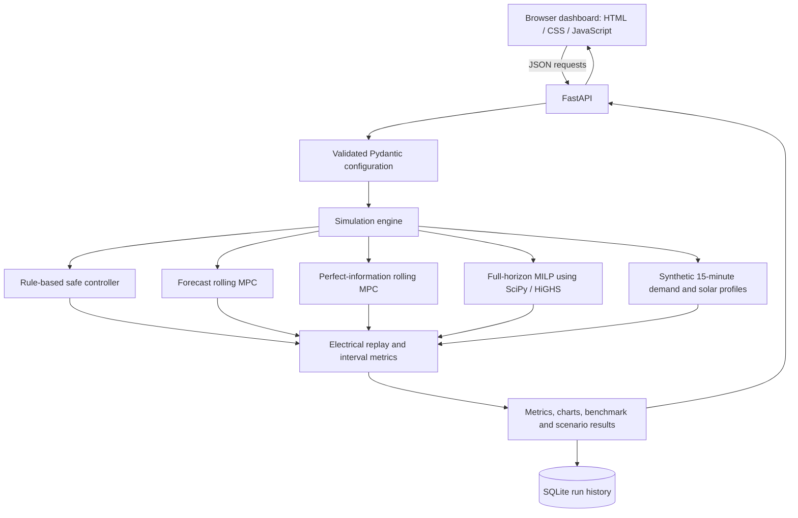

# Architecture

## High-level flow

## Components

- `backend/app/models.py`: user-editable configuration and input validation. It checks SOC relationships, tariff assumptions, sizing bounds, and other configuration constraints.
- `backend/app/simulator.py`: deterministic scenario generator, tariff engine, PV clipping, battery / inverter and DG models, rule-based controller, rolling MPC, MILP, electrical replay, billing metrics, outage test, and capacity sweep.
- `backend/app/main.py`: API routes and serves the compiled-as-static dashboard assets from the same origin.
- `backend/app/repository.py`: stores a full simulation result plus configuration in SQLite. The DB file is configured using `GRIDWISE_DB_PATH`.
- `backend/app/static/`: responsive, dependency-free frontend. It uses fetch requests to call the API; no separate Node/npm build is needed.
- `backend/tests/`: unit and API integration tests.

## Simulation sequence

1. Validate a scenario configuration.
2. Generate a deterministic set of 15-minute profiles for the selected archetype.
3. Execute the solar/grid baseline and rule-based controller.
4. Execute the full-horizon MILP diagnostic.
5. Run forecast-error MPC and the perfect-information MPC using the same re-planning cadence.
6. Replay each controller's actions through the common electrical model, including SOC, power flow, PF / kVA, transformer constraints, generator use and modeled wear.
7. Calculate metrics and the forecasting benchmark; persist the result when requested from `/api/simulate`.
8. Use stored interval profiles for outage test, charts, detail view and CSV export.

## Operational reliability

The optimizer can raise an exception or return no usable solution. In that case, `_solve_milp` uses a rule-based fallback and marks `fallback_used` in its diagnostics. Forecast MPC includes an economic guard that can choose a rule-based action schedule if its modelled forecast-window candidate is more expensive. The fallback is a demonstration controller, not a safety-certified industrial control function.

## Security and deployment notes

- The default app is intended to run on the local machine. The development launcher binds to `127.0.0.1`.
- Do not expose this demo to the public internet without authentication, rate limiting, logging policy review, secure configuration, and deployment hardening.
- It does not connect to a PLC, SCADA system, meter, inverter, battery-management system, or DG controller.
- Keep the SQLite database and environment files out of source control.
